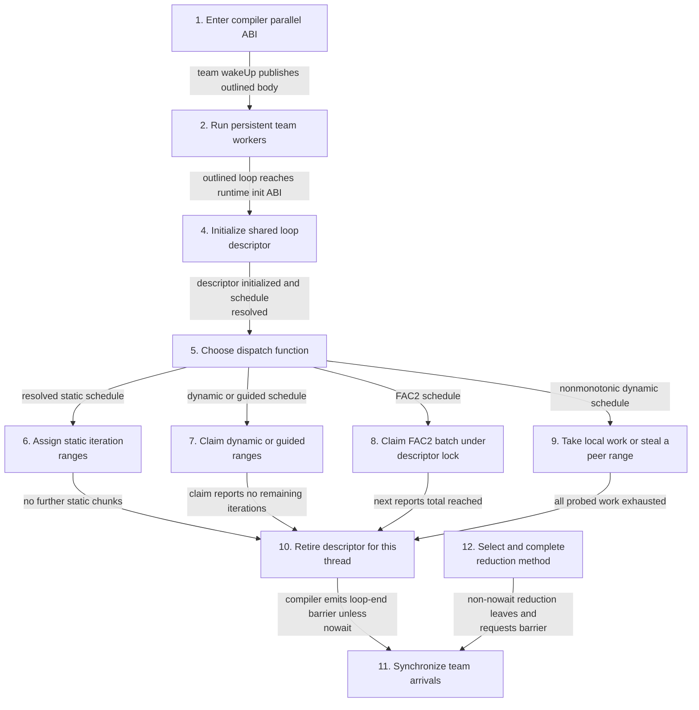
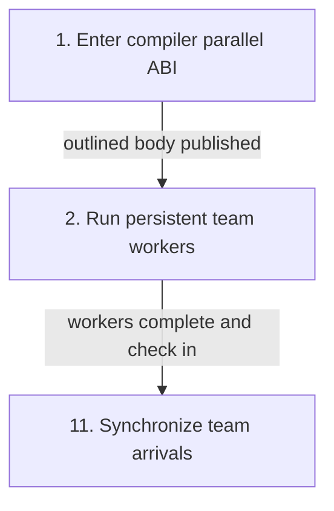
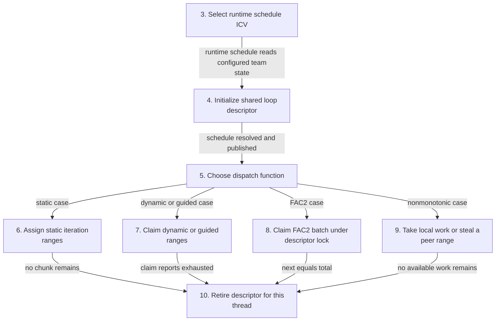
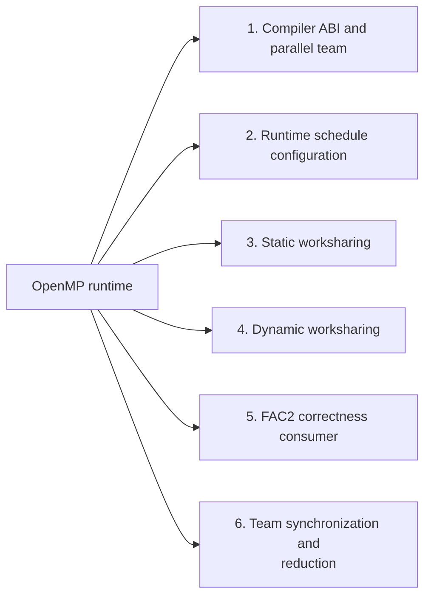
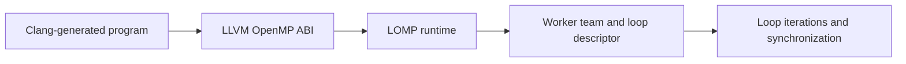
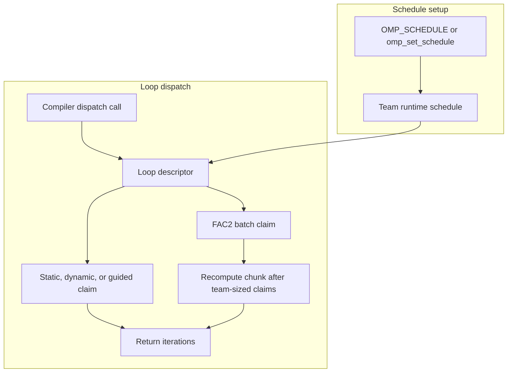

# OpenMP runtime

A small LLVM compiler ABI runtime with an added factoring-2 (FAC2) loop
scheduler. FAC2 lets Clang-compiled `schedule(runtime)` loops use dynamically
claimed chunks whose size is recomputed after each team-sized batch.

This repository extends the complete [LOMP runtime](https://github.com/parallel-runtimes/lomp),
which provides persistent workers, compiler dispatch entry points, standard
static/dynamic/guided schedules, synchronization, reductions, and tasks. The
upstream README is preserved in [`README.upstream.md`](README.upstream.md), and
the upstream license and source history remain in the repository.

## Architecture and execution guide

<!-- execution-flow:start -->
### Execution flow

Start with the primary path, then expand a detailed workflow. Select a numbered node to see its operation, implementation techniques, and source. Solid arrows show the named control, data, or lifecycle handoff; dotted arrows show error paths. Separate entry points are named in each workflow.

<a id="review-walkthrough"></a>

#### Walk through one concrete example

A compiler-generated parallel loop selects the FAC2 runtime schedule with minimum chunk 4 and dispatches its worksharing iterations.

**Trace.** [Select runtime schedule ICV](#flow-step-choose-schedule) → [Initialize shared loop descriptor](#flow-step-initialize-descriptor) → [Choose dispatch function](#flow-step-dispatch-selection) → [Claim FAC2 batch under descriptor lock](#flow-step-fac2-claim) → [Retire descriptor for this thread](#flow-step-end-loop).

**Result and boundary.** The runtime selects FAC2 for the loop descriptor, issues bounded batches under that descriptor's mutex, and retires the descriptor for the thread when dispatch finishes. Dispatch exhaustion does not itself call the worksharing barrier; synchronization follows the separate team/reduction path when required by the construct.

<details>
<summary>Implementation decisions to explain</summary>

**Why keep FAC2 state on the loop descriptor?** Each active loop gets its own claim state, preventing overlapping nowait loops from sharing indices. The state must be reset when descriptors are initialized or reused.

[Descriptor-local scheduler lifecycle](#technique-descriptor-local-lifecycle).

**Why serialize FAC2 claims with a descriptor mutex?** The next range and remaining batch slots are updated together, so one lock protects the claim invariant. Each claim pays the mutex cost.

[Mutex-serialized FAC2 claims](#technique-fac2-serialized-claims).

</details>

#### Primary execution flow

Compiler ABI calls enter a persistent team, initialize a per-team loop descriptor, then select a concrete scheduling path. Independent runtime configuration and consumer verification are detailed separately.



**Detailed workflows.** [Run an outlined parallel region](#flow-workflow-parallel-region) · [Configure schedule selection](#flow-workflow-runtime-schedule-configuration) · [Dispatch worksharing iterations](#flow-workflow-worksharing-schedules) · [Verify FAC2 coverage and reduction](#flow-workflow-fac2-verification).

<a id="flow-workflow-parallel-region"></a>

<details>
<summary>Run an outlined parallel region</summary>

The ABI wakes persistent workers, runs the body on the master, then checks the team in and leaves parallel mode.



</details>

<a id="flow-workflow-runtime-schedule-configuration"></a>

<details>
<summary>Configure schedule selection</summary>

Independent configuration path: omp_set_schedule updates the current team's ICV; environment parsing happens when team loop state initializes.


</details>

<a id="flow-workflow-worksharing-schedules"></a>

<details>
<summary>Dispatch worksharing iterations</summary>

After loop initialization, each resolved schedule selects its own claim path. The paths converge when the thread has no further iterations.



</details>

<a id="flow-workflow-fac2-verification"></a>

<details>
<summary>Verify FAC2 coverage and reduction</summary>

Separate test consumer selects FAC2, checks exact coverage, reduction and descriptor reuse; this path validates implementation and is not production dispatch.


</details>

#### Steps, techniques, and source

These source traces cover the active scope below. They explain implementation behavior; benchmark results and their limits remain in the measurement sections.

<a id="flow-step-abi-fork"></a>

##### 1. Enter compiler parallel ABI

**Component.** __kmpc_fork_call. The ABI packs the compiler thunk and arguments, initializes the current thread and team, rejects nested parallel regions, wakes the team with the body, runs it on the master, then checks in and leaves parallel mode.

**Techniques at this step.** [Compiler ABI dispatch](#technique-compiler-abi-dispatch) · [Persistent worker team and fork barrier](#technique-persistent-worker-team).

**Source.** [`src/entrypoints.cc:119`](https://github.com/STEVVVU/openmp-runtime/blob/main/src/entrypoints.cc#L119). [Back to execution flow](#execution-flow).

<a id="flow-step-team-workers"></a>

##### 2. Run persistent team workers

**Component.** ThreadTeam and Thread::outerLoop. The established team owns persistent worker threads. Workers wait for fork work and execute the published InvocationInfo until the barrier completes the region.

**Techniques at this step.** [Persistent worker team and fork barrier](#technique-persistent-worker-team).

**Source.** [`src/threads.cc:57`](https://github.com/STEVVVU/openmp-runtime/blob/main/src/threads.cc#L57) · [`src/threads.cc:169`](https://github.com/STEVVVU/openmp-runtime/blob/main/src/threads.cc#L169). [Back to execution flow](#execution-flow).

<a id="flow-step-choose-schedule"></a>

##### 3. Select runtime schedule ICV

**Component.** omp_set_schedule and initializeLoops. omp_set_schedule stores the mapped schedule and chunk in the current team. Runtime initialization reads OMP_SCHEDULE when present, maps recognized names, and warns then uses static for an unknown name.

**Techniques at this step.** [Team-scoped runtime schedule selection](#technique-team-runtime-schedule) · [Environment schedule parsing and fallback](#technique-schedule-environment-fallback).

**Source.** [`src/entrypoints.cc:61`](https://github.com/STEVVVU/openmp-runtime/blob/main/src/entrypoints.cc#L61) · [`src/loops.cc:132`](https://github.com/STEVVVU/openmp-runtime/blob/main/src/loops.cc#L132) · [`src/loops.cc:59`](https://github.com/STEVVVU/openmp-runtime/blob/main/src/loops.cc#L59). [Back to execution flow](#execution-flow).

<a id="flow-step-initialize-descriptor"></a>

##### 4. Initialize shared loop descriptor

**Component.** initDynamicLoop and computeDynamicLoopParams. The first team thread to claim an uninitialized descriptor resolves runtime and auto schedules, canonicalizes bounds, resets FAC2 state, and publishes initialization. Other threads yield until publication; each then sets any thread-local static chunk state.

**Techniques at this step.** [Team-scoped runtime schedule selection](#technique-team-runtime-schedule) · [Descriptor-local scheduler lifecycle](#technique-descriptor-local-lifecycle).

**Source.** [`src/loops.cc:333`](https://github.com/STEVVVU/openmp-runtime/blob/main/src/loops.cc#L333) · [`src/loops.cc:233`](https://github.com/STEVVVU/openmp-runtime/blob/main/src/loops.cc#L233) · [`src/loops.h:388`](https://github.com/STEVVVU/openmp-runtime/blob/main/src/loops.h#L388). [Back to execution flow](#execution-flow).

<a id="flow-step-dispatch-selection"></a>

##### 5. Choose dispatch function

**Component.** dynamicLoop::setSchedule. The resolved schedule installs the static, chunked-static, guided, FAC2, monotonic dynamic, or nonmonotonic dispatch function. Unsupported values call fatalError.

**Techniques at this step.** [Dynamic claims with compare-and-swap](#technique-dynamic-atomic-claims) · [Guided claims that shrink with remaining work](#technique-guided-claims) · [Factoring-2 batch claims](#technique-fac2-batch-claims) · [Nonmonotonic dynamic work stealing](#technique-nonmonotonic-work-stealing) · [Static blocked and cyclic partitioning](#technique-static-block-cyclic-partition).

**Source.** [`src/loops.cc:712`](https://github.com/STEVVVU/openmp-runtime/blob/main/src/loops.cc#L712). [Back to execution flow](#execution-flow).

<a id="flow-step-static-dispatch"></a>

##### 6. Assign static iteration ranges

**Component.** canonicalLoop::forStaticInit and static dispatchers. Unchunked static work obtains its canonical blocked range once per thread. Chunked static advances through cyclic chunk indices by the team size and returns false when a thread's next chunk is beyond the iteration count.

**Techniques at this step.** [Static blocked and cyclic partitioning](#technique-static-block-cyclic-partition).

**Source.** [`src/loops.cc:140`](https://github.com/STEVVVU/openmp-runtime/blob/main/src/loops.cc#L140) · [`src/loops.cc:470`](https://github.com/STEVVVU/openmp-runtime/blob/main/src/loops.cc#L470). [Back to execution flow](#execution-flow).

<a id="flow-step-dynamic-claims"></a>

##### 7. Claim dynamic or guided ranges

**Component.** dynamicLoop::dispatchMonotonic and dispatchGuided. Monotonic dynamic claims one canonical iteration with compare-and-swap and yields after a failed claim. Guided computes a shrinking share from remaining iterations, caps at the end, and retries failed compare-and-swap claims.

**Techniques at this step.** [Dynamic claims with compare-and-swap](#technique-dynamic-atomic-claims) · [Guided claims that shrink with remaining work](#technique-guided-claims).

**Source.** [`src/loops.cc:556`](https://github.com/STEVVVU/openmp-runtime/blob/main/src/loops.cc#L556) · [`src/loops.cc:497`](https://github.com/STEVVVU/openmp-runtime/blob/main/src/loops.cc#L497). [Back to execution flow](#execution-flow).

<a id="flow-step-fac2-claim"></a>

##### 8. Claim FAC2 batch under descriptor lock

**Component.** fac2Scheduler::next and dispatchFac2. The descriptor mutex protects end detection, batch-size calculation, the next index, and claim count. Each batch uses the ceiling of remaining work divided by twice the worker count, bounded by minimum chunk and remaining iterations.

**Techniques at this step.** [Factoring-2 batch claims](#technique-fac2-batch-claims) · [Mutex-serialized FAC2 claims](#technique-fac2-serialized-claims) · [Descriptor-local scheduler lifecycle](#technique-descriptor-local-lifecycle).

**Source.** [`src/fac2.h:39`](https://github.com/STEVVVU/openmp-runtime/blob/main/src/fac2.h#L39) · [`src/loops.cc:536`](https://github.com/STEVVVU/openmp-runtime/blob/main/src/loops.cc#L536). [Back to execution flow](#execution-flow).

<a id="flow-step-nonmonotonic-steal"></a>

##### 9. Take local work or steal a peer range

**Component.** dispatchNonmonotonic and contiguousWork. A thread first increments its local base; if no local iterations remain and the loop is unfinished, it probes another thread's range and attempts a half-range steal. Failed claims report no iterations or continue probing according to the dispatch loop.

**Techniques at this step.** [Nonmonotonic dynamic work stealing](#technique-nonmonotonic-work-stealing).

**Source.** [`src/loops.cc:583`](https://github.com/STEVVVU/openmp-runtime/blob/main/src/loops.cc#L583) · [`src/loops.cc:759`](https://github.com/STEVVVU/openmp-runtime/blob/main/src/loops.cc#L759) · [`src/loops.cc:819`](https://github.com/STEVVVU/openmp-runtime/blob/main/src/loops.cc#L819). [Back to execution flow](#execution-flow).

<a id="flow-step-end-loop"></a>

##### 10. Retire descriptor for this thread

**Component.** __kmpc_dispatch_next and Thread::endDynamicLoop. When the selected dispatch function reports no iterations, the compiler ABI calls endDynamicLoop so the thread advances its dynamic-loop state and the descriptor can be reused after the team completes its users.

**Techniques at this step.** [Descriptor-local scheduler lifecycle](#technique-descriptor-local-lifecycle) · [Compiler ABI dispatch](#technique-compiler-abi-dispatch).

**Source.** [`src/loops.cc:896`](https://github.com/STEVVVU/openmp-runtime/blob/main/src/loops.cc#L896) · [`src/threads.h:265`](https://github.com/STEVVVU/openmp-runtime/blob/main/src/threads.h#L265). [Back to execution flow](#execution-flow).

<a id="flow-step-team-barrier"></a>

##### 11. Synchronize team arrivals

**Component.** Barrier::newBarrier, fixedTreeCheckIn, and LBWBroadcast. The configured barrier implementation checks workers into its tree and releases them through broadcast flags. The fork join path uses checkIn after the master body; nowait loop completion omits its end barrier.

**Techniques at this step.** [Tree check-in with flag broadcast](#technique-tree-checkin-flag-broadcast).

**Source.** [`src/threads.cc:373`](https://github.com/STEVVVU/openmp-runtime/blob/main/src/threads.cc#L373) · [`src/barrier_impl.cc:538`](https://github.com/STEVVVU/openmp-runtime/blob/main/src/barrier_impl.cc#L538) · [`src/barrier_impl.cc:142`](https://github.com/STEVVVU/openmp-runtime/blob/main/src/barrier_impl.cc#L142). [Back to execution flow](#execution-flow).

<a id="flow-step-reduction"></a>

##### 12. Select and complete reduction method

**Component.** Thread::chooseReduction, enterReduction, and leaveReduction. Reduction entry chooses compiler-supported atomic combination or enters the runtime critical lock. Leave releases a used lock and performs the team barrier for the non-nowait form; unsupported forced modes follow the coded warning and fallback.

**Techniques at this step.** [Compiler-selected atomic or critical reduction](#technique-compiler-selected-reduction).

**Source.** [`src/threads.cc:434`](https://github.com/STEVVVU/openmp-runtime/blob/main/src/threads.cc#L434) · [`src/threads.cc:467`](https://github.com/STEVVVU/openmp-runtime/blob/main/src/threads.cc#L467) · [`src/threads.cc:494`](https://github.com/STEVVVU/openmp-runtime/blob/main/src/threads.cc#L494). [Back to execution flow](#execution-flow).

<a id="flow-step-fac2-consumer"></a>

##### 13. Check FAC2 coverage and reduction

**Component.** tests/test_fac2.cc main. The consumer selects FAC2 through the runtime API, checks the returned schedule, runs parallel loops that record exact iteration coverage and reduction results, and exercises reuse of loop descriptors. This verifies runtime behavior; it is not a production dispatch stage.

**Techniques at this step.** [Exact-coverage FAC2 checks](#technique-fac2-exact-coverage-checks).

**Source.** [`tests/test_fac2.cc:23`](https://github.com/STEVVVU/openmp-runtime/blob/main/tests/test_fac2.cc#L23). [Back to execution flow](#execution-flow).

<details>
<summary>Scope and subsystem coverage</summary>

Clang compiler ABI parallel entry, persistent team, team schedule ICV and environment selection, static and dynamic/guided/FAC2/nonmonotonic loop dispatch, descriptor lifecycle, barriers, reductions, and FAC2 consumer checks.

- **Compiler ABI and parallel team.** The ABI packs and publishes outlined work to the persistent team, with nested parallelism rejected. [Step 1](#flow-step-abi-fork), [Step 2](#flow-step-team-workers).
- **Runtime schedule configuration.** Team ICV and OMP_SCHEDULE parsing feed resolved descriptor scheduling state. [Step 3](#flow-step-choose-schedule), [Step 4](#flow-step-initialize-descriptor).
- **Static worksharing.** Blocked and cyclic static partition routines assign canonical ranges. [Step 6](#flow-step-static-dispatch).
- **Dynamic worksharing.** Dispatch callback selection covers dynamic, guided, FAC2, stealing and per-thread descriptor completion. [Step 5](#flow-step-dispatch-selection), [Step 7](#flow-step-dynamic-claims), [Step 8](#flow-step-fac2-claim), [Step 9](#flow-step-nonmonotonic-steal), [Step 10](#flow-step-end-loop).
- **FAC2 correctness consumer.** The dedicated consumer checks exact iteration coverage, reduction, and descriptor reuse. [Step 13](#flow-step-fac2-consumer).
- **Team synchronization and reduction.** The runtime supplies tree check-in/broadcast barriers and compiler-selected atomic or critical reduction coordination. [Step 11](#flow-step-team-barrier), [Step 12](#flow-step-reduction).

Outside this flow audit:

- `README.upstream.md`. Preserved upstream reference is not executable runtime behavior.
- `examples/`. Demonstrations are outside the active ABI/FAC2 consumer path.
- `src/tasking.cc`. Task queue behavior is outside the assigned parallel team and loop schedule scope.

</details>

<!-- execution-flow:end -->

<details>
<summary>Subsystem technique index</summary>

### Subsystem map

Select a subsystem in the diagram to open its techniques, tradeoffs, and code references. The numbered links provide the same navigation. This map groups components; the execution diagrams show their runtime flow.



1. [Compiler ABI and parallel team](#subsystem-compiler-abi-and-parallel-team)
2. [Runtime schedule configuration](#subsystem-runtime-schedule-configuration)
3. [Static worksharing](#subsystem-static-worksharing)
4. [Dynamic worksharing](#subsystem-dynamic-worksharing)
5. [FAC2 correctness consumer](#subsystem-fac2-correctness-consumer)
6. [Team synchronization and reduction](#subsystem-team-synchronization-and-reduction)

LOMP implements a compiler-facing subset of the LLVM OpenMP runtime ABI. The inherited runtime supplies teams, synchronization, tasks, reductions and ordinary loop schedules. This repository adds [FAC2](#fac2-batch) through the existing [runtime-schedule](#runtime-schedule) path. It does not claim complete OpenMP compliance.

The compiler calls exported [ABI](#compiler-abi) entry points. Team state selects the runtime schedule, and a [loop descriptor](#loop-descriptor) tracks iteration claims. FAC2's descriptor-local state batches claims, while other schedules keep their existing implementation.

</details>

<details>
<summary>Expand flow diagram 1</summary>



</details>

Caption: a compiled consumer enters LOMP through the ABI, which distributes work to its worker team.

<details>
<summary>Expand flow diagram 2</summary>



</details>

Caption: setup stores schedule choice on the team; dispatch uses that choice and returns claimed iterations. FAC2 recalculates its chunk after each batch.

| Subsystem | Responsibility and owned state | Source |
| --- | --- | --- |
| ABI entry points | Translate compiler calls into runtime operations. | [`src/entrypoints.cc`](src/entrypoints.cc), [`src/interface.h`](src/interface.h) |
| Team and workers | Own team membership, worker lifecycle and per-team schedule settings. | [`src/threads.cc`](src/threads.cc), [`src/threads.h`](src/threads.h) |
| Loop dispatch | Parse schedule choice and manage compiler loop descriptors and claims. | [`src/loops.cc`](src/loops.cc), [`src/loops.h`](src/loops.h) |
| FAC2 arithmetic | Compute bounded chunk sizes and next claim from remaining iterations. | [`src/fac2.h`](src/fac2.h) |
| Environment parsing | Read runtime settings and fall back when values cannot be parsed. | [`src/environment.cc`](src/environment.cc) |

Execution journey:

1. Clang emits calls to the LLVM OpenMP ABI when it compiles a parallel loop.
2. LOMP creates or joins the current worker team and loads its runtime scheduling setting from `OMP_SCHEDULE` or the API.
3. Compiler initialization creates the loop descriptor and determines the iteration range.
4. Workers claim chunks according to the selected schedule. FAC2 holds its descriptor-local claim lock while it updates the remaining range and batch count.
5. Workers finish the loop and follow the compiler-requested synchronization path. If the environment schedule is unknown, LOMP warns and uses static scheduling.

| Choice in the current implementation | Practical rationale | Alternative and cost to reconsider |
| --- | --- | --- |
| Add FAC2 to `dynamicLoop` and runtime schedule selection. | Reuses compiler ABI and descriptor lifecycle already used by dynamic scheduling. | A separate scheduler API would require compiler-facing changes and duplicate dispatch paths. |
| Keep FAC2 claim state on each loop descriptor. | Concurrent `nowait` loops need independent remaining-range and batch state. | Team-global state would couple overlapping descriptors. |
| Recalculate after up to team-size claims. | Matches the bounded FAC2 batching rule documented here. | Recalculating on every claim changes the algorithm and lock frequency. |
| Keep `auto` mapped to its existing internal behavior. | FAC2 is an explicit extension and does not silently redefine standard schedule values. | Redirecting `auto` would change existing consumer behavior. |

These rationales are inferred from the current implementation; no historical intent is claimed.

<a id="compiler-abi"></a>

<details><summary>What is the compiler ABI?</summary>

The application binary interface is the set of symbols and calling conventions a compiler expects from a runtime. Here, Clang-generated code calls LOMP entry points such as the loop dispatch functions. The ABI lets the runtime change how iterations are assigned without changing the source loop.
</details>

<a id="loop-descriptor"></a>

<details><summary>What is a loop descriptor?</summary>

A loop descriptor stores the iteration range and claim state for one compiler-generated worksharing loop. LOMP keeps FAC2's remaining-range and batch state there, so overlapping loops do not share claims.
</details>

<a id="runtime-schedule"></a>

<details><summary>What is a runtime schedule?</summary>

A runtime schedule is a loop policy selected while the program runs, often through `OMP_SCHEDULE` or `omp_set_schedule`. For example, `OMP_SCHEDULE=fac2,4` selects FAC2 with a minimum chunk of four iterations.
</details>

<a id="fac2-batch"></a>

<details><summary>What is a FAC2 batch?</summary>

A FAC2 batch permits up to team-size chunk claims before the runtime recomputes its chunk size, regardless of which worker makes each claim. In a four-worker team, the runtime recalculates after four claims or when the loop runs out of work.
</details>

<a id="nowait-loop"></a>

<details><summary>What is a `nowait` loop?</summary>

A `nowait` loop omits the usual end-of-loop barrier, allowing workers to continue. Another loop can therefore overlap in the same team, which is why each LOMP descriptor must own its own scheduling state.
</details>

<a id="schedule-fallback"></a>

<details><summary>What is the schedule fallback?</summary>

The parser maps recognized schedule names to internal policies. When `OMP_SCHEDULE` names an unknown policy, `src/loops.cc` warns and selects static scheduling instead of failing program startup.
</details>

## Implementation techniques

This section covers active FAC2 scheduling and the inherited runtime paths it uses. The implementation and rationale link above remain authoritative for broader runtime scope.

<details>
<summary>Full technique index</summary>

| Subsystem | Technique cards | Source |
| --- | --- | --- |
| Compiler ABI and parallel team | [compiler ABI dispatch](#technique-compiler-abi-dispatch), [persistent worker team](#technique-persistent-worker-team) | [`src/interface.h`](src/interface.h), [`src/entrypoints.cc`](src/entrypoints.cc), [`src/threads.cc`](src/threads.cc), [`src/threads.h`](src/threads.h) |
| Runtime schedule configuration | [team-scoped schedule selection](#technique-team-runtime-schedule), [environment parsing and fallback](#technique-schedule-environment-fallback) | [`src/globals.cc`](src/globals.cc), [`src/loops.cc`](src/loops.cc), [`src/environment.cc`](src/environment.cc) |
| Static worksharing | [blocked and cyclic partitions](#technique-static-block-cyclic-partition) | [`src/loops.cc`](src/loops.cc), [`src/loops.h`](src/loops.h) |
| Dynamic worksharing | [dynamic atomic claims](#technique-dynamic-atomic-claims), [guided claims](#technique-guided-claims), [nonmonotonic work stealing](#technique-nonmonotonic-work-stealing), [FAC2 batch claims](#technique-fac2-batch-claims), [FAC2 mutex claims](#technique-fac2-serialized-claims), [descriptor-local lifecycle](#technique-descriptor-local-lifecycle) | [`src/loops.cc`](src/loops.cc), [`src/loops.h`](src/loops.h), [`src/fac2.h`](src/fac2.h), [`src/threads.h`](src/threads.h) |
| Team synchronization and reduction | [Tree check-in and flag broadcast](#technique-tree-checkin-flag-broadcast), [Atomic or critical reduction](#technique-compiler-selected-reduction) | [`src/threads.cc`](src/threads.cc), [`src/barrier_impl.cc`](src/barrier_impl.cc), [`src/locks.cc`](src/locks.cc) |
| FAC2 correctness consumer | [exact-coverage checks](#technique-fac2-exact-coverage-checks) | [`tests/test_fac2.cc`](tests/test_fac2.cc) |

</details>

The table covers the active compiler dispatch and worksharing paths in this repository, plus the mapped FAC2 correctness consumer. It excludes preserved examples and unrelated runtime subsystems.

<a id="subsystem-compiler-abi-and-parallel-team"></a>

### 1. Compiler ABI and parallel team

[Back to the subsystem map](#architecture-and-execution-guide).

**Code.** [`src/entrypoints.cc`](src/entrypoints.cc), [`src/interface.h`](src/interface.h), [`src/threads.cc`](src/threads.cc), [`src/threads.h`](src/threads.h).

**Techniques.** [Compiler ABI dispatch](#technique-compiler-abi-dispatch), [Persistent worker team and fork barrier](#technique-persistent-worker-team).

**Related concepts.** [compiler ABI](#compiler-abi), [loop descriptor](#loop-descriptor).

<a id="technique-compiler-abi-dispatch"></a>

<details>
<summary>Compiler ABI dispatch</summary>

**Mechanism.** Clang calls LLVM-compatible symbols such as `__kmpc_fork_call` and width-specific `__kmpc_dispatch_init_*` and `__kmpc_dispatch_next_*`. The runtime initializes the loop descriptor once, stores a schedule-specific member-function pointer, and invokes that function for each claim. This keeps loop policy behind the compiler ABI.

**Example.** A compiler-generated runtime-scheduled loop enters through `__kmpc_dispatch_init_4`, requests bounds through `__kmpc_dispatch_next_4`, then lets the runtime mark the thread done when no range remains.

**Why here.** FAC2 plugs into the existing dispatch entry points, so consumers can select it through `schedule(runtime)` without a new compiler interface.

**Tradeoffs.** The runtime must match the compiler's symbol names, data widths, and calling conventions. This ABI subset does not imply full OpenMP support.

**Code and ownership.** [`src/interface.h`](src/interface.h#L123) declares the fork entry point. [`src/entrypoints.cc`](src/entrypoints.cc#L119) handles parallel entry; [`src/loops.cc`](src/loops.cc#L890) expands the dispatch wrappers. Inherited.


**Used in.** [Compiler ABI and parallel team](#subsystem-compiler-abi-and-parallel-team). [Back to the subsystem map](#architecture-and-execution-guide).

</details>

<a id="technique-persistent-worker-team"></a>

<details>
<summary>Persistent worker team and fork barrier</summary>

**Mechanism.** `ThreadTeam` creates the requested workers once. Each worker's `outerLoop` checks out work at the team's barrier, runs the invocation, checks in, and waits for another fork. `__kmpc_fork_call` wakes the barrier, runs the same invocation on the master thread, then checks in and leaves the parallel region.

**Example.** `__kmpc_fork_call` marks the team active, publishes an invocation through the barrier, and later waits for workers to finish before returning to serial execution.

**Why here.** The loop scheduler can hand claims to established team members without creating operating-system threads for every parallel region.

**Tradeoffs.** Workers remain alive and team size cannot change inside a parallel region. LOMP rejects nested parallelism and does not implement general team resizing.

**Code and ownership.** [`src/threads.cc`](src/threads.cc#L57) constructs a team and [`src/threads.cc`](src/threads.cc#L169) runs workers; [`src/entrypoints.cc`](src/entrypoints.cc#L149) wakes the barrier and [`src/entrypoints.cc`](src/entrypoints.cc#L155) checks in the master. Inherited.


**Used in.** [Compiler ABI and parallel team](#subsystem-compiler-abi-and-parallel-team). [Back to the subsystem map](#architecture-and-execution-guide).

</details>

<a id="subsystem-runtime-schedule-configuration"></a>

### 2. Runtime schedule configuration

[Back to the subsystem map](#architecture-and-execution-guide).

**Code.** [`src/globals.cc`](src/globals.cc), [`src/entrypoints.cc`](src/entrypoints.cc), [`src/threads.h`](src/threads.h), [`src/loops.cc`](src/loops.cc), [`src/environment.cc`](src/environment.cc).

**Techniques.** [Team-scoped runtime schedule selection](#technique-team-runtime-schedule), [Environment schedule parsing and fallback](#technique-schedule-environment-fallback).

**Related concepts.** [runtime schedule](#runtime-schedule).

<a id="technique-team-runtime-schedule"></a>

<details>
<summary>Team-scoped runtime schedule selection</summary>

**Mechanism.** The team stores a runtime schedule and chunk. `OMP_SCHEDULE` initializes those fields when the runtime starts; `omp_set_schedule` updates them through the same setter. At loop initialization, `computeDynamicLoopParams` replaces `schedule(runtime)` with the team's concrete policy and chunk before selecting dispatch.

**Example.** `omp_set_schedule(omp_sched_dynamic, 4)` makes later `schedule(runtime)` loops use dynamic four-iteration chunks in that team.

**Why here.** One team-owned setting connects the environment and public API to the compiler's runtime schedule path.

**Tradeoffs.** The setter is explicitly documented as not thread-safe. A change affects subsequent loop initialization, not a descriptor that already captured its schedule.

**Code and ownership.** [`src/threads.h`](src/threads.h#L128) stores the values; [`src/loops.cc`](src/loops.cc#L113) sets them and [`src/loops.cc`](src/loops.cc#L233) resolves them. Inherited.


**Used in.** [Runtime schedule configuration](#subsystem-runtime-schedule-configuration). [Back to the subsystem map](#architecture-and-execution-guide).

</details>

<a id="technique-schedule-environment-fallback"></a>

<details>
<summary>Environment schedule parsing and fallback</summary>

**Mechanism.** `OMP_SCHEDULE` is split at its comma into a schedule name and integer chunk. `lookupSchedule` maps recognized names to ABI schedule values. An unknown name warns and becomes static; a chunk conversion failure leaves the team at its initial static default because `initializeLoops` applies the setting only after successful conversion.

**Example.** `OMP_SCHEDULE=fac2,4` selects FAC2 with chunk 4. `OMP_SCHEDULE=unknown,4` warns and selects static with chunk 4.

**Why here.** The runtime accepts both startup configuration and the public schedule API, while an unknown environment schedule does not prevent runtime initialization.

**Tradeoffs.** The parser handles one comma-separated integer argument and does not implement the full OpenMP environment grammar. `std::stoi` may accept a numeric prefix before trailing characters.

**Code and ownership.** [`src/environment.cc`](src/environment.cc#L69) parses the pair; [`src/loops.cc`](src/loops.cc#L59) maps names and [`src/loops.cc`](src/loops.cc#L132) initializes the team. Inherited.


**Used in.** [Runtime schedule configuration](#subsystem-runtime-schedule-configuration). [Back to the subsystem map](#architecture-and-execution-guide).

</details>

<a id="subsystem-static-worksharing"></a>

### 3. Static worksharing

[Back to the subsystem map](#architecture-and-execution-guide).

**Code.** [`src/loops.cc`](src/loops.cc), [`src/loops.h`](src/loops.h).

**Techniques.** [Static blocked and cyclic partitioning](#technique-static-block-cyclic-partition).

<a id="technique-static-block-cyclic-partition"></a>

<details>
<summary>Static blocked and cyclic partitioning</summary>

**Mechanism.** The blocked schedule divides canonical iterations by team size, gives one extra iteration to each of the first remainder threads, and returns one contiguous range per thread. The chunked form starts each thread at its thread index and advances by the team size, producing cyclic chunks. Runtime-dispatched cyclic scheduling returns one chunk per call.

**Example.** With ten canonical iterations and four threads, the blocked ranges have lengths 3, 3, 2, and 2. With chunk size 1, the cyclic form assigns indices 0, 1, 2, 3, then 4, 5, 6, 7, and so on.

**Why here.** Both policies use the canonical loop bounds already passed by Clang and need no shared claim counter.

**Tradeoffs.** Static assignment does not react to iteration cost. Cyclic runtime scheduling also needs a runtime dispatch call for each chunk.

**Code and ownership.** [`src/loops.cc`](src/loops.cc#L140) partitions static ranges; [`src/loops.cc`](src/loops.cc#L470) dispatches cyclic chunks. Inherited.


**Used in.** [Static worksharing](#subsystem-static-worksharing). [Back to the subsystem map](#architecture-and-execution-guide).

</details>

<a id="subsystem-dynamic-worksharing"></a>

### 4. Dynamic worksharing

[Back to the subsystem map](#architecture-and-execution-guide).

**Code.** [`src/loops.cc`](src/loops.cc), [`src/loops.h`](src/loops.h), [`src/threads.h`](src/threads.h), [`src/fac2.h`](src/fac2.h).

**Techniques.** [Dynamic claims with compare-and-swap](#technique-dynamic-atomic-claims), [Guided claims that shrink with remaining work](#technique-guided-claims), [Nonmonotonic dynamic work stealing](#technique-nonmonotonic-work-stealing), [Factoring-2 batch claims](#technique-fac2-batch-claims), [Mutex-serialized FAC2 claims](#technique-fac2-serialized-claims), [Descriptor-local scheduler lifecycle](#technique-descriptor-local-lifecycle).

**Related concepts.** [compiler ABI](#compiler-abi), [loop descriptor](#loop-descriptor), [nowait loop](#nowait-loop).

<a id="technique-dynamic-atomic-claims"></a>

<details>
<summary>Dynamic claims with compare-and-swap</summary>

**Mechanism.** Monotonic dynamic dispatch loads the shared next canonical iteration and attempts to advance it by one with compare-and-swap. A successful thread converts that canonical index to loop bounds. A failed compare retries after yielding. The canonical loop has already divided the user iteration range by the requested chunk size, so each claim can represent that chunk.

**Example.** With chunk size 4, successive successful claims return canonical indices 0, 1, 2, then map to user iterations 0–3, 4–7, and 8–11.

**Why here.** Threads claim work as they become available, which suits loops whose iteration costs vary.

**Tradeoffs.** Contending workers update one shared counter, and failed compare-and-swap attempts retry. This path does not reserve a batch of claims.

**Code and ownership.** [`src/loops.cc`](src/loops.cc#L556) implements `dynamicLoop::dispatchMonotonic`; [`src/loops.cc`](src/loops.cc#L712) selects it. Inherited.


**Used in.** [Dynamic worksharing](#subsystem-dynamic-worksharing). [Back to the subsystem map](#architecture-and-execution-guide).

</details>

<a id="technique-guided-claims"></a>

<details>
<summary>Guided claims that shrink with remaining work</summary>

**Mechanism.** Guided dispatch reads the next canonical index, computes the remaining count, and proposes half of the rounded-up per-thread share. A compare-and-swap reserves that range; failure retries with refreshed state. The proposed range therefore shrinks as other threads claim work, down to the implementation's one-iteration floor.

**Example.** If 100 canonical iterations remain for four threads, a claimant proposes 13 iterations: half of the rounded-up share of 25 is rounded up to 13.

**Why here.** Guided scheduling combines larger early claims with smaller later claims using the runtime's shared next-index state.

**Tradeoffs.** The implementation chooses one-half of the per-thread share rather than exposing a tuning parameter. Concurrent updates can make a proposal stale, so the claimant retries.

**Code and ownership.** [`src/loops.cc`](src/loops.cc#L497) implements `dynamicLoop::dispatchGuided`; [`src/loops.cc`](src/loops.cc#L712) selects it. Inherited.


**Used in.** [Dynamic worksharing](#subsystem-dynamic-worksharing). [Back to the subsystem map](#architecture-and-execution-guide).

</details>

<a id="technique-nonmonotonic-work-stealing"></a>

<details>
<summary>Nonmonotonic dynamic work stealing</summary>

**Mechanism.** Initialization divides canonical iterations into balanced contiguous ranges. A thread consumes its own range first. When empty, it visits victims from a random starting point; `trySteal` atomically shortens a victim's range by roughly half and returns the stolen tail. Started-iteration counters let a worker mark the loop finished once all work has begun.

**Example.** If a worker exhausts its local interval while another has a range of 20 unstarted iterations, a successful steal takes about 10 and leaves the rest available to that owner or another thief.

**Why here.** The nonmonotonic dynamic path rebalances remaining static ranges without routing every local iteration through one global claim counter.

**Tradeoffs.** Stealing uses shared atomic range state and random victim scans. Iteration order is not preserved, and this implementation calls the scheme an area for improvement.

**Code and ownership.** [`src/loops.cc`](src/loops.cc#L583) scans for work; [`src/loops.cc`](src/loops.cc#L759) consumes local ranges and [`src/loops.cc`](src/loops.cc#L819) steals them. Inherited.


**Used in.** [Dynamic worksharing](#subsystem-dynamic-worksharing). [Back to the subsystem map](#architecture-and-execution-guide).

</details>

<a id="technique-fac2-batch-claims"></a>

<details>
<summary>Factoring-2 batch claims</summary>

**Mechanism.** `fac2Scheduler::next` locks descriptor state, computes `ceil(remaining / (2 * workers))` with quotient and remainder, clamps it to the minimum chunk, and permits up to `workers` claims before recalculation, regardless of which worker claims them. Each claim is capped at remaining iterations.

**Example.** With 4 workers and 100 iterations, a batch begins with 13 iterations per claim. After four claims the scheduler recomputes from the remaining range.

**Why here.** The runtime exposes FAC2 as a runtime-selected dynamic schedule and can distribute irregular loop ranges without compiler changes.

**Tradeoffs.** Each claim takes the descriptor mutex. A large first batch can leave a heavy prefix on one worker. Changing the minimum affects claim size only when it constrains the computed chunk, so lowering it does not generally fix that imbalance.

**Code and ownership.** [`src/fac2.h`](src/fac2.h#L19) defines the extension; [`src/loops.cc`](src/loops.cc#L536) maps canonical indices back to loop bounds. Extension.


**Used in.** [Dynamic worksharing](#subsystem-dynamic-worksharing). [Back to the subsystem map](#architecture-and-execution-guide).

</details>

<a id="technique-fac2-serialized-claims"></a>

<details>
<summary>Mutex-serialized FAC2 claims</summary>

**Mechanism.** `fac2Scheduler::next` holds its descriptor-local mutex while it checks completion, starts a batch if needed, assigns a range, advances `next_`, and consumes one batch slot. Reset uses the same mutex, so the range and batch counters change together.

**Example.** Two workers entering `next` together receive consecutive, non-overlapping ranges because each completes the read, update, and slot decrement before the other enters the critical section.

**Why here.** The FAC2 counters form one allocation state. Protecting the state together keeps a claim unique without a multiword atomic protocol.

**Tradeoffs.** Every claim takes a mutex, including claims in an active batch. The dynamic dispatch paths use different atomic strategies, and FAC2 does not currently batch-lock amortization across multiple claims.

**Code and ownership.** [`src/fac2.h`](src/fac2.h#L29) guards reset and [`src/fac2.h`](src/fac2.h#L40) guards `next`. Extension.


**Used in.** [Dynamic worksharing](#subsystem-dynamic-worksharing). [Back to the subsystem map](#architecture-and-execution-guide).

</details>

<a id="technique-descriptor-local-lifecycle"></a>

<details>
<summary>Descriptor-local scheduler lifecycle</summary>

**Mechanism.** Existing compiler loop descriptors own the FAC2 scheduler. Initialization resets total iterations, next index, worker count, minimum chunk and batch slots; dispatch consumes only that descriptor's state.

**Example.** Two overlapping `nowait` loops have separate next indices and cannot claim each other's iterations.

**Why here.** The existing descriptor lifecycle already separates concurrent worksharing loops and preserves the compiler ABI.

**Tradeoffs.** State must be reset whenever a descriptor is initialized or reused. Team-global state would be smaller but would couple simultaneous loops.

**Code and ownership.** [`src/loops.cc`](src/loops.cc#L271) selects FAC2 and [`src/fac2.h`](src/fac2.h#L29) resets its state. Mixed: inherited descriptor lifecycle and extension scheduler.


**Used in.** [Dynamic worksharing](#subsystem-dynamic-worksharing). [Back to the subsystem map](#architecture-and-execution-guide).

</details>

<a id="subsystem-fac2-correctness-consumer"></a>

### 5. FAC2 correctness consumer

[Back to the subsystem map](#architecture-and-execution-guide).

**Code.** [`tests/test_fac2.cc`](tests/test_fac2.cc).

**Techniques.** [Exact-coverage FAC2 checks](#technique-fac2-exact-coverage-checks).

**Related concepts.** [compiler ABI](#compiler-abi), [nowait loop](#nowait-loop).

<a id="technique-fac2-exact-coverage-checks"></a>

<details>
<summary>Exact-coverage FAC2 checks</summary>

**Mechanism.** The FAC2 consumer selects the schedule through `omp_set_schedule`, runs `schedule(runtime)` loops, increments a per-iteration counter, and compares reductions with a serial sum. It repeats one loop 100 times, checks overlapping `nowait` loops, exercises signed and unsigned loop widths, and checks a minimum chunk larger than the remaining tail.

**Example.** The 1000-entry `seen` array must contain exactly one for every canonical iteration, while the parallel reduction must equal the independently accumulated serial sum.

**Why here.** These assertions catch lost or duplicated claims and descriptor-state leakage through the actual compiler ABI consumer.

**Tradeoffs.** The test proves these correctness cases, not scheduler balance, a performance advantage, or all OpenMP semantics.

**Code and ownership.** [`tests/test_fac2.cc`](tests/test_fac2.cc#L23) selects FAC2; [`tests/test_fac2.cc`](tests/test_fac2.cc#L34) checks exact coverage and reduction, and later cases check overlap, type widths, and tail handling. Extension.


**Used in.** [FAC2 correctness consumer](#subsystem-fac2-correctness-consumer). [Back to the subsystem map](#architecture-and-execution-guide).

</details>

<a id="subsystem-team-synchronization-and-reduction"></a>

### 6. Team synchronization and reduction

[Back to the subsystem map](#architecture-and-execution-guide).

**Code.** [`src/threads.cc`](src/threads.cc), [`src/entrypoints.cc`](src/entrypoints.cc), [`src/barrier_impl.cc`](src/barrier_impl.cc), [`src/locks.cc`](src/locks.cc), [`tests/test_fac2.cc`](tests/test_fac2.cc).

**Techniques.** [Tree check-in with flag broadcast](#technique-tree-checkin-flag-broadcast), [Compiler-selected atomic or critical reduction](#technique-compiler-selected-reduction).

**Related concepts.** [compiler ABI](#compiler-abi).

<a id="technique-tree-checkin-flag-broadcast"></a>

<details>
<summary>Tree check-in with flag broadcast</summary>

**Mechanism.** The team creates one selectable barrier. The default FT16FlagLBW4 combines a fixed fan-in-16 arrival tree with flag counters and a flat release broadcast shared by four polling threads per cache line. Arrival information moves toward the root; release flags let waiting workers proceed. Alternating state separates repeated barrier rounds. The wrapper processes task-barrier bookkeeping before the selected check-in.

**Example.** The compiler ABI fork path broadcasts the outlined body to waiting workers, runs the body on the main thread, then checks in at join. A normal loop or reduction completion can use the same team barrier; nowait deliberately omits its end barrier.

**Why here.** The existing team synchronization can be reused by FAC2 consumers without adding a separate scheduler-level barrier.

**Tradeoffs.** Polling and broadcast traffic depend on team size and machine topology. An environment override selects other inherited algorithms, so the default structure is not a universal performance claim. A worker that never arrives can hold up the team.

**Code and ownership.** [`Barrier::newBarrier`](src/threads.cc#L373), [`fixedTreeCheckIn`](src/barrier_impl.cc#L538), [`LBWBroadcast`](src/barrier_impl.cc#L142), and [`fork ABI`](src/entrypoints.cc#L149), inherited LOMP.


**Used in.** [Team synchronization and reduction](#subsystem-team-synchronization-and-reduction). [Back to the subsystem map](#architecture-and-execution-guide).

</details>

<a id="technique-compiler-selected-reduction"></a>

<details>
<summary>Compiler-selected atomic or critical reduction</summary>

**Mechanism.** Reduction entry points ask the current thread to choose an available method from compiler flags and optional runtime configuration. Returning 2 asks compiler-generated code to perform its atomic combine; returning 1 enters the runtime critical lock before the compiler combine. Reduction exit releases that lock when used and performs a team barrier for the non-nowait form.

**Example.** The FAC2 correctness consumer uses `reduction(+:sum)` while checking claimed iterations. Its arithmetic combine comes from compiler-generated code; the runtime selects and coordinates the permitted combine path.

**Why here.** FAC2 loops can retain ordinary reduction semantics through the inherited compiler ABI.

**Tradeoffs.** Atomic combining needs compiler support, and a critical combine serializes updates. This runtime does not implement tree reduction; unsupported forced choices warn and fall back as coded. A scheduling coverage test does not demonstrate every reduction type or all OpenMP semantics.

**Code and ownership.** [`chooseReduction` and `enterReduction`](src/threads.cc#L434), [`leaveReduction`](src/threads.cc#L494), [`critical lock entry`](src/locks.cc#L428), and [`FAC2 consumer`](tests/test_fac2.cc#L36), inherited runtime used by the extension consumer.


**Used in.** [Team synchronization and reduction](#subsystem-team-synchronization-and-reduction). [Back to the subsystem map](#architecture-and-execution-guide).

</details>

## Guide

[Implementation techniques](#implementation-techniques) ·
[Architecture and execution guide](#architecture-and-execution-guide) · [FAC2 schedule](#fac2-schedule) · [Build and verify](#build-and-verify) · [Native measurements](#native-measurements) · [Scope and limitations](#scope-and-limitations) · [Coursework and research](#coursework-and-research)

## FAC2 schedule

At the start of a batch, FAC2 computes

```text
chunk = max(minimum_chunk, ceil(remaining_iterations / (2 * team_size)))
```

It keeps that chunk size for up to team-size claims, then recomputes
from the remaining range. The final claim is capped at the remaining work.
Integer quotient/remainder implements ceiling division without overflowing the
addition. FAC2 is a bounded scheduling implementation inspired by the paper;
it is not a reproduction of the paper's evaluation or a guarantee of a speedup.

Select the extension for `schedule(runtime)` with either:

```sh
OMP_SCHEDULE=fac2,4 ./your-program
```

or the public runtime API:

```cpp
omp_set_schedule(lomp_sched_fac2, 4);
#pragma omp parallel for schedule(runtime)
for (int i = 0; i < count; ++i) {
  // Work for i.
}
```

The chunk argument is the minimum chunk in loop iterations. Standard OpenMP
schedule values retain their existing behavior; `auto` is not redirected to
FAC2.

## Build and verify

LOMP supports Linux and macOS. It intentionally rejects Windows in
[`src/target.h`](src/target.h). On Linux with Clang, CMake, Ninja, pthread
headers, and LLVM OpenMP development headers installed, run:

```sh
bash scripts/verify-openmp-runtime.sh all
```

The driver builds the runtime and consumers, runs the complete CTest suite,
checks that the FAC2 consumer resolves to this build's `libomp`, and compares
the same irregular loop against the installed Clang runtime. It removes only
its marked build directory. Configure, build, test, benchmark, and linkage logs
remain under `artifacts/native-runs/`. Native Linux verification passed in
[run 39718820166](https://github.com/STEVVVU/openmp-runtime/actions/runs/39718820166).
All 25 CTest entries, actual LOMP/system-library linkage checks, benchmark
checksums and the injected-failure cleanup control passed. The [retained
evidence](docs/evidence/linux-39718820166/) includes every measured sample.

The standalone arithmetic check uses only C++17 and can run on Windows. It
validates FAC2 claim arithmetic, not the OpenMP runtime.

## Native measurements

[Run 39729269942](https://github.com/STEVVVU/openmp-runtime/actions/runs/39729269942)
passed all 25 CTest entries, LOMP/LLVM linkage checks, 450 measurement processes
and the separate failure-cleanup control. Source was `88108a219e4ccbea20c591d0ff337acb1cd49826`,
using Ubuntu 24.04, Clang/LLVM OpenMP 18.1.3 Release and an AMD EPYC 7763 VM
reporting four logical CPUs on two cores. Five alternating runtime pairs per
configuration followed a schedule warmup. All measured outputs matched their
serial checksum with zero errors.

For 1048576 iterations, 4096 maximum recurrence rounds and four workers,
elapsed milliseconds were median (full range):

| Kernel | LOMP FAC2 | LLVM guided | LOMP dynamic, chunk 1 |
| --- | ---: | ---: | ---: |
| Balanced | 169.13 (168.98..171.27) | 169.02 (168.91..170.45) | 184.42 (184.17..185.10) |
| Irregular | 89.21 (89.15..89.27) | 89.23 (89.15..89.29) | 105.41 (105.29..105.56) |
| Clustered heavy prefix | 87.48 (87.21..87.53) | 86.55 (86.44..86.79) | 42.68 (42.48..42.81) |

FAC2 has no measurable advantage over LLVM guided on balanced or irregular
work here. Its balanced one/two/four-worker medians were 654.75/337.55/169.13 ms;
the corresponding serial control was about 651 ms. These are logical-worker
results on this VM, not four physical-core scaling guarantees.

The clustered case exposes a schedule tradeoff. FAC2's first chunk contains
the entire heavy prefix, leaving one worker with 99.829% of useful recurrence
work. Guided shows the same imbalance. The existing dynamic schedule is faster
for this case. Changing FAC2's initial batching to remove that imbalance would
change its documented algorithm. The complete matrix preserves that result
alongside the smaller overhead controls; 210 of 405 summary groups include a
sample below 10 ms. No general runtime or scheduling speedup is claimed.

Reproduce the full matrix, separate syscall profiles and owned cleanup with:

```sh
LOMP_VERIFY_RUN_ID=fresh-metrics LOMP_METRICS=1 bash scripts/verify-openmp-runtime.sh all
```

[All compact summaries and raw hashes](docs/evidence/linux-39729269942/) include
serial controls, per-worker work, resources, environment and profile limits.
Kernel timing includes parallel-region startup/barriers and counters, excludes
allocation and serial reference construction, and is separate from process
CPU/RSS. Peak process RSS ranged from 7988 to 21344 KiB.

## Scope and limitations

This runtime implements a subset of OpenMP through the LLVM-compatible ABI. It
does not claim full OpenMP compliance, nested parallelism, or changing a team's
size inside a parallel region. The FAC2 claim step uses one descriptor-local
mutex acquisition per chunk. No performance result is claimed without native,
interleaved measurements against equivalent work and inputs.

## Coursework and research

- The course project reference is the [CMU `omp0` final report](https://vnnm404.github.io/webpage/final.html),
  which motivates implementing the worksharing runtime and comparing loop
  schedules.
- The FAC2 mechanism follows the simplified batching formulation in
  [Buder, Ciorba, and Iwainsky, “OpenMP Loop Scheduling Revisited: Making a Case
  for More Schedules”](https://arxiv.org/abs/1809.03188) and the [author's thesis,
  section 2.2.2.5](https://hpc.dmi.unibas.ch/wp-content/uploads/sites/87/2019/11/2018_patrick_buder_ma_thesisjanuary2018.pdf).
