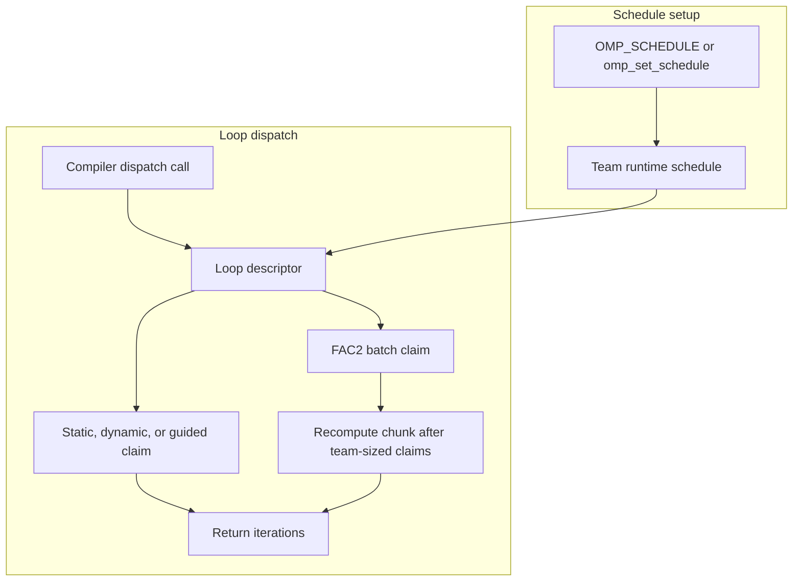

# OpenMP runtime

A small LLVM compiler ABI runtime with an added factoring-2 (FAC2) loop
scheduler. FAC2 lets Clang-compiled `schedule(runtime)` loops use dynamically
claimed chunks whose size is recomputed after each team-sized batch.

This repository extends the complete [LOMP runtime](https://github.com/parallel-runtimes/lomp),
which provides persistent workers, compiler dispatch entry points, standard
static/dynamic/guided schedules, synchronization, reductions, and tasks. The
upstream README is preserved in [`README.upstream.md`](README.upstream.md), and
the upstream license and source history remain in the repository.

## Guide

[Architecture and execution guide](#architecture-and-execution-guide) · [FAC2 schedule](#fac2-schedule) · [Build and verify](#build-and-verify) · [Native measurements](#native-measurements) · [Scope and limitations](#scope-and-limitations) · [Coursework and research](#coursework-and-research)

## Architecture and execution guide

LOMP implements a compiler-facing subset of the LLVM OpenMP runtime ABI. The inherited runtime supplies teams, synchronization, tasks, reductions and ordinary loop schedules. This repository adds [FAC2](#fac2-batch) through the existing [runtime-schedule](#runtime-schedule) path. It does not claim complete OpenMP compliance.

The compiler calls exported [ABI](#compiler-abi) entry points. Team state selects the runtime schedule, and a [loop descriptor](#loop-descriptor) tracks iteration claims. FAC2's descriptor-local state batches claims, while other schedules keep their existing implementation.


Caption: a compiled consumer enters LOMP through the ABI, which distributes work to its worker team.



Caption: setup stores schedule choice on the team; dispatch uses that choice and returns claimed iterations. FAC2 recalculates its chunk after each batch.

| Subsystem | Responsibility and owned state | Source |
| --- | --- | --- |
| ABI entry points | Translate compiler calls into runtime operations. | [`src/entrypoints.cc`](src/entrypoints.cc), [`src/interface.h`](src/interface.h) |
| Team and workers | Own team membership, worker lifecycle and per-team schedule settings. | [`src/threads.cc`](src/threads.cc), [`src/threads.h`](src/threads.h) |
| Loop dispatch | Parse schedule choice and manage compiler loop descriptors and claims. | [`src/loops.cc`](src/loops.cc), [`src/loops.h`](src/loops.h) |
| FAC2 arithmetic | Compute bounded chunk sizes and next claim from remaining iterations. | [`src/fac2.h`](src/fac2.h) |
| Environment parsing | Read runtime settings and fall back when values cannot be parsed. | [`src/environment.cc`](src/environment.cc) |

Execution journey:

1. Clang emits calls to the LLVM OpenMP ABI when it compiles a parallel loop.
2. LOMP creates or joins the current worker team and loads its runtime scheduling setting from `OMP_SCHEDULE` or the API.
3. Compiler initialization creates the loop descriptor and determines the iteration range.
4. Workers claim chunks according to the selected schedule. FAC2 holds its descriptor-local claim lock while it updates the remaining range and batch count.
5. Workers finish the loop and follow the compiler-requested synchronization path. If the environment schedule is unknown, LOMP warns and uses static scheduling.

| Choice in the current implementation | Practical rationale | Alternative and cost to reconsider |
| --- | --- | --- |
| Add FAC2 to `dynamicLoop` and runtime schedule selection. | Reuses compiler ABI and descriptor lifecycle already used by dynamic scheduling. | A separate scheduler API would require compiler-facing changes and duplicate dispatch paths. |
| Keep FAC2 claim state on each loop descriptor. | Concurrent `nowait` loops need independent remaining-range and batch state. | Team-global state would couple overlapping descriptors. |
| Recalculate after up to one claim per worker. | Matches the bounded FAC2 batching rule documented here. | Recalculating on every claim changes the algorithm and lock frequency. |
| Keep `auto` mapped to its existing internal behavior. | FAC2 is an explicit extension and does not silently redefine standard schedule values. | Redirecting `auto` would change existing consumer behavior. |

These rationales are inferred from the current implementation; no historical intent is claimed.

<a id="compiler-abi"></a>

<details><summary>What is the compiler ABI?</summary>

The application binary interface is the set of symbols and calling conventions a compiler expects from a runtime. Here, Clang-generated code calls LOMP entry points such as the loop dispatch functions. The ABI lets the runtime change how iterations are assigned without changing the source loop.
</details>

<a id="loop-descriptor"></a>

<details><summary>What is a loop descriptor?</summary>

A loop descriptor stores the iteration range and claim state for one compiler-generated worksharing loop. LOMP keeps FAC2's remaining-range and batch state there, so overlapping loops do not share claims.
</details>

<a id="runtime-schedule"></a>

<details><summary>What is a runtime schedule?</summary>

A runtime schedule is a loop policy selected while the program runs, often through `OMP_SCHEDULE` or `omp_set_schedule`. For example, `OMP_SCHEDULE=fac2,4` selects FAC2 with a minimum chunk of four iterations.
</details>

<a id="fac2-batch"></a>

<details><summary>What is a FAC2 batch?</summary>

A FAC2 batch is up to one chunk claim per worker before the runtime recomputes its chunk size. In a four-worker team, the runtime recalculates after four claims or when the loop runs out of work.
</details>

<a id="nowait-loop"></a>

<details><summary>What is a `nowait` loop?</summary>

A `nowait` loop omits the usual end-of-loop barrier, allowing workers to continue. Another loop can therefore overlap in the same team, which is why each LOMP descriptor must own its own scheduling state.
</details>

<a id="schedule-fallback"></a>

<details><summary>What is the schedule fallback?</summary>

The parser maps recognized schedule names to internal policies. When `OMP_SCHEDULE` names an unknown policy, `src/loops.cc` warns and selects static scheduling instead of failing program startup.
</details>

## FAC2 schedule

At the start of a batch, FAC2 computes

```text
chunk = max(minimum_chunk, ceil(remaining_iterations / (2 * team_size)))
```

It keeps that chunk size for up to one claim per team thread, then recomputes
from the remaining range. The final claim is capped at the remaining work.
Integer quotient/remainder implements ceiling division without overflowing the
addition. FAC2 is a bounded scheduling implementation inspired by the paper;
it is not a reproduction of the paper's evaluation or a guarantee of a speedup.

Select the extension for `schedule(runtime)` with either:

```sh
OMP_SCHEDULE=fac2,4 ./your-program
```

or the public runtime API:

```cpp
omp_set_schedule(lomp_sched_fac2, 4);
#pragma omp parallel for schedule(runtime)
for (int i = 0; i < count; ++i) {
  // Work for i.
}
```

The chunk argument is the minimum chunk in loop iterations. Standard OpenMP
schedule values retain their existing behavior; `auto` is not redirected to
FAC2.

## Build and verify

LOMP supports Linux and macOS. It intentionally rejects Windows in
[`src/target.h`](src/target.h). On Linux with Clang, CMake, Ninja, pthread
headers, and LLVM OpenMP development headers installed, run:

```sh
bash scripts/verify-openmp-runtime.sh all
```

The driver builds the runtime and consumers, runs the complete CTest suite,
checks that the FAC2 consumer resolves to this build's `libomp`, and compares
the same irregular loop against the installed Clang runtime. It removes only
its marked build directory. Configure, build, test, benchmark, and linkage logs
remain under `artifacts/native-runs/`. Native Linux verification passed in
[run 39718820166](https://github.com/STEVVVU/openmp-runtime/actions/runs/39718820166).
All 25 CTest entries, actual LOMP/system-library linkage checks, benchmark
checksums and the injected-failure cleanup control passed. The [retained
evidence](docs/evidence/linux-39718820166/) includes every measured sample.

The standalone arithmetic check uses only C++17 and can run on Windows. It
validates FAC2 claim arithmetic, not the OpenMP runtime.

## Native measurements

[Run 39729269942](https://github.com/STEVVVU/openmp-runtime/actions/runs/39729269942)
passed all 25 CTest entries, LOMP/LLVM linkage checks, 450 measurement processes
and the separate failure-cleanup control. Source was `88108a219e4ccbea20c591d0ff337acb1cd49826`,
using Ubuntu 24.04, Clang/LLVM OpenMP 18.1.3 Release and an AMD EPYC 7763 VM
reporting four logical CPUs on two cores. Five alternating runtime pairs per
configuration followed a schedule warmup. All measured outputs matched their
serial checksum with zero errors.

For 1048576 iterations, 4096 maximum recurrence rounds and four workers,
elapsed milliseconds were median (full range):

| Kernel | LOMP FAC2 | LLVM guided | LOMP dynamic, chunk 1 |
| --- | ---: | ---: | ---: |
| Balanced | 169.13 (168.98..171.27) | 169.02 (168.91..170.45) | 184.42 (184.17..185.10) |
| Irregular | 89.21 (89.15..89.27) | 89.23 (89.15..89.29) | 105.41 (105.29..105.56) |
| Clustered heavy prefix | 87.48 (87.21..87.53) | 86.55 (86.44..86.79) | 42.68 (42.48..42.81) |

FAC2 has no measurable advantage over LLVM guided on balanced or irregular
work here. Its balanced one/two/four-worker medians were 654.75/337.55/169.13 ms;
the corresponding serial control was about 651 ms. These are logical-worker
results on this VM, not four physical-core scaling guarantees.

The clustered case exposes a schedule tradeoff. FAC2's first chunk contains
the entire heavy prefix, leaving one worker with 99.829% of useful recurrence
work. Guided shows the same imbalance. The existing dynamic schedule is faster
for this case. Changing FAC2's initial batching to remove that imbalance would
change its documented algorithm. The complete matrix preserves that result
alongside the smaller overhead controls; 210 of 405 summary groups include a
sample below 10 ms. No general runtime or scheduling speedup is claimed.

Reproduce the full matrix, separate syscall profiles and owned cleanup with:

```sh
LOMP_VERIFY_RUN_ID=fresh-metrics LOMP_METRICS=1 bash scripts/verify-openmp-runtime.sh all
```

[All compact summaries and raw hashes](docs/evidence/linux-39729269942/) include
serial controls, per-worker work, resources, environment and profile limits.
Kernel timing includes parallel-region startup/barriers and counters, excludes
allocation and serial reference construction, and is separate from process
CPU/RSS. Peak process RSS ranged from 7988 to 21344 KiB.

## Scope and limitations

This runtime implements a subset of OpenMP through the LLVM-compatible ABI. It
does not claim full OpenMP compliance, nested parallelism, or changing a team's
size inside a parallel region. The FAC2 claim step uses one descriptor-local
mutex acquisition per chunk. No performance result is claimed without native,
interleaved measurements against equivalent work and inputs.

## Coursework and research

- The course project reference is the [CMU `omp0` final report](https://vnnm404.github.io/webpage/final.html),
  which motivates implementing the worksharing runtime and comparing loop
  schedules.
- The FAC2 mechanism follows the simplified batching formulation in
  [Buder, Ciorba, and Iwainsky, “OpenMP Loop Scheduling Revisited: Making a Case
  for More Schedules”](https://arxiv.org/abs/1809.03188) and the [author's thesis,
  section 2.2.2.5](https://hpc.dmi.unibas.ch/wp-content/uploads/sites/87/2019/11/2018_patrick_buder_ma_thesisjanuary2018.pdf).
